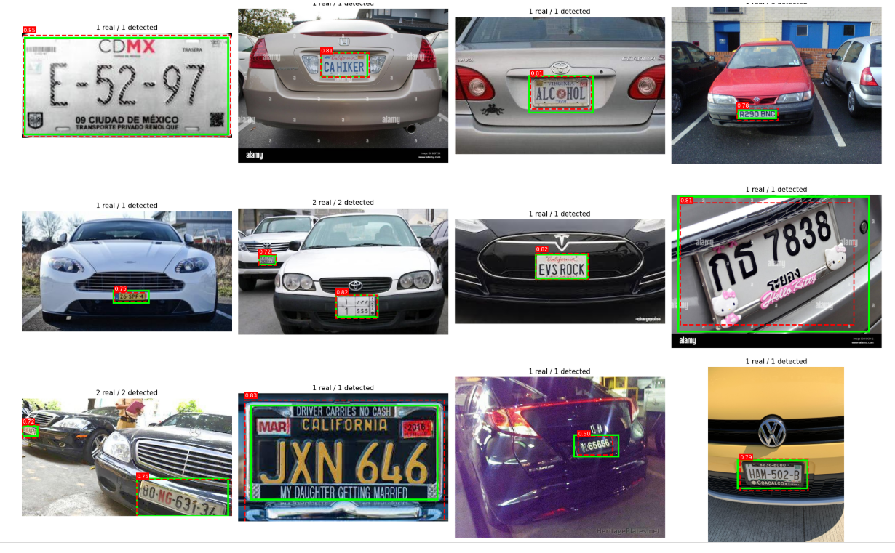
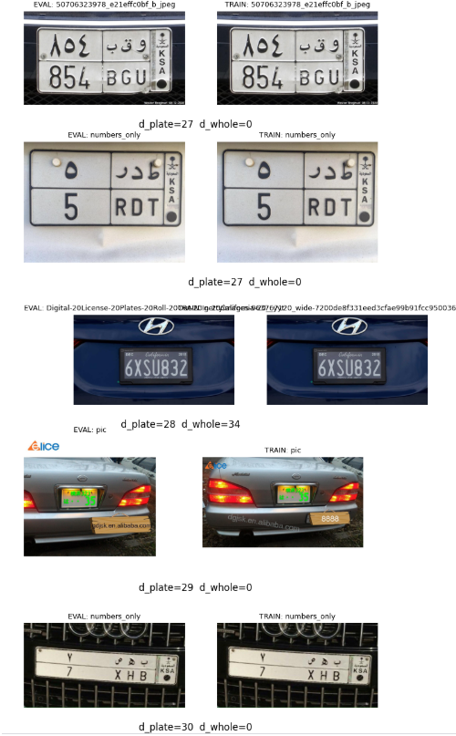
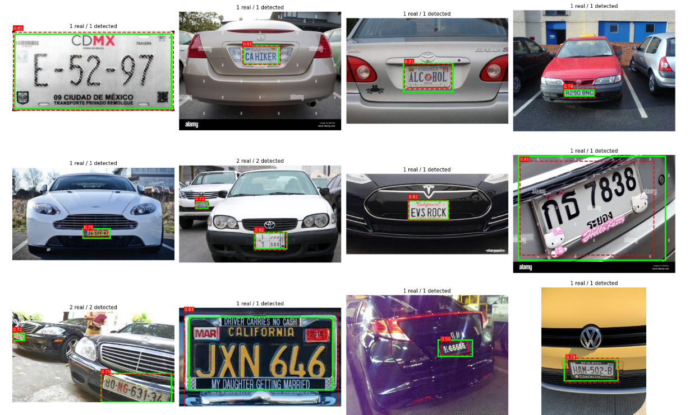
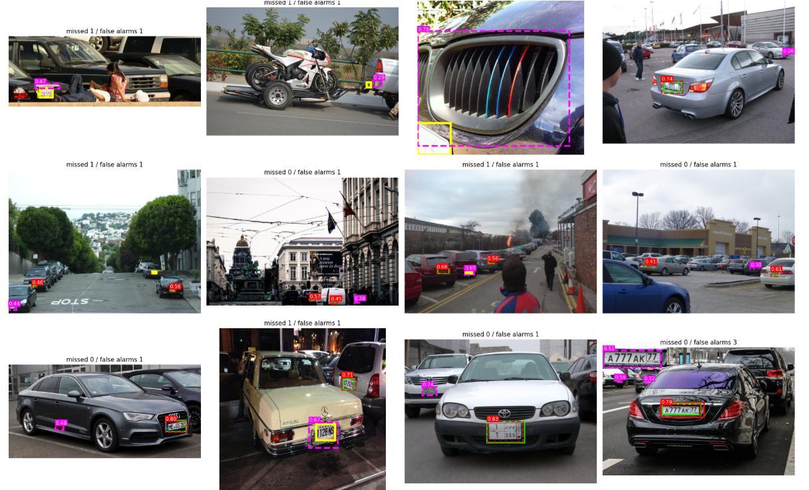

# Plates Detector

License plate detection with **YOLO26**, trained on a cleaned version of a public 10,000-image dataset and served through a **Streamlit** web app.

[](https://plates-detector-v26.streamlit.app)


**Try it:** [plates-detector-v26.streamlit.app](https://plates-detectorv26.streamlit.app/). Upload a photo of a vehicle and every plate is boxed, cropped and enlarged, with its confidence score.

---

## Results

Scores on **398 test images** that were never used for training or for choosing the best epoch. The test set only contains varied real-world photos: different countries, angles, distances and lighting.

| | Precision | Recall | mAP50 | mAP50-95 |
|---|:---:|:---:|:---:|:---:|
| Validation | 0.931 | 0.891 | 0.928 | 0.580 |
| **Test** | **0.922** | **0.892** | **0.910** | **0.564** |

On photos it has never seen, the model finds about **9 plates out of 10**, and **92%** of its detections are real plates. Validation and test scores are almost identical, which shows the model generalises rather than fitting the validation set.

<p align="center">
  
  <br><em>Test images. Green: labelled plate. Dashed red: prediction with confidence.</em>
</p>

---

## The important part: fixing data leakage

The dataset ([License Plate Recognition](https://www.kaggle.com/datasets/adilshamim8/license-plate-recognition), Kaggle) comes with a ready-made train/valid/test split. Before training, I checked where the images came from, and that split turned out to be unreliable.

### What was wrong

Roboflow keeps the original file name before `_jpg.rf.<hash>`, which reveals that the dataset is a merge of several sources:

- **About 73% of the images come from one fixed parking camera**: same angle, same barrier, same floor (`CarLongPlate`, `CarLongPlateGen`, `xemay`).
- **4,322 images are augmented copies** of other images: rotated, shifted, cropped or brightened (`CarLongPlateGen` and the four `*quandoi` variants).
- Near-identical images also hide under different names: consecutive frames of the same vehicle, or the same web photo saved twice.

The original split was random, so an image could be in train while its copy was in test. A model evaluated that way is tested on pictures it has already seen, and its score is inflated.

<p align="center">
  
  <br><em>Examples of the same image found in both the evaluation set and the training set.</em>
</p>

### How I fixed it

1. **Merged all 10,125 images** into one pool and dropped the original split.
2. **Fingerprinted every image** with two perceptual hashes (dHash): one on the whole image and one on the plate crop. The plate fingerprint matters because, with a fixed camera, two different cars share the same background but not the same plate.
3. **Linked near-duplicates** with three rules (same image, same car, same plate), then merged them into **9,852 groups**. A group always stays in a single split.
4. **Kept the parking-camera images and every augmented family in train only.** Fingerprints can't reliably match a rotated or cropped copy to its original, so this is the only way to rule out leakage from those sources.
5. **Split the remaining real-world photos by group** into 60 / 20 / 20, stratified by source.

**Final split: 9,333 train / 394 valid / 398 test**, checked automatically so that no group is cut across splits and no train-only image ends up in valid or test.

The scores above are lower than the 95%+ often seen on plate datasets, but they are honest: they measure performance on new, varied photos.

---

## Training

| Setting | Value |
|---|---|
| Model | YOLO26s, pretrained on COCO |
| Epochs | 30 |
| Image size | 640 |
| Batch | 16 |
| Extra augmentation | rotation ±5°, light perspective, stronger brightness changes (on top of the Ultralytics defaults) |
| Hardware | Kaggle, NVIDIA T4, about 70 minutes |

<p align="center">
  
</p>

---

## Error analysis

On the test set: **462 plates, 41 missed, 50 false alarms.**

- **Small, distant plates are the main weakness.** Missed plates cover a median of 0.28% of the image, against 2.25% for plates that are found. They are about 8 times smaller.
- **Most false alarms are real plates.** In street scenes the model finds the plates of cars in the background, but only the main plate was labelled, so these count as errors. The real precision is higher than the score.
- **The genuine mistakes are rare**, for example the vertical bars of a car grille read as characters.

<p align="center">
  
  <br><em>Yellow: missed plate. Dashed magenta: false alarm.</em>
</p>

---

## Project structure

```
Plates-Detector/
├── app.py                          Streamlit app
├── best.pt                         trained YOLO26s weights
├── requirements.txt                Python dependencies
├── packages.txt                    system packages for Streamlit Cloud
├── .streamlit/config.toml          app theme
├── notebooks/
│   ├── 01_data_and_training.ipynb  data analysis, leakage fix, split, training
│   └── 02_evaluation.ipynb         test score and error analysis
└── assets/                         images used in this README
```

## Run locally

```bash
git clone https://github.com/soufianessadik/Plates-Detector.git
cd Plates-Detector
pip install -r requirements.txt
streamlit run app.py
```

The app opens at `http://localhost:8501`. It runs on CPU.

To reproduce the training, open the notebooks on Kaggle, add the dataset as input and run them in order with a GPU.

---

## Next steps

- **Read the plate number** (OCR) on the cropped plates.
- **Train at a larger image size** (`imgsz=960`) to recover small, distant plates.
- **Label the background plates** in street photos, for more accurate scores and better recall on distant plates.
- **Video support** in the app.

## License and credits

- Code released under **AGPL-3.0**, the license of [Ultralytics YOLO](https://github.com/ultralytics/ultralytics).
- Dataset: [License Plate Recognition](https://www.kaggle.com/datasets/adilshamim8/license-plate-recognition) by adilshamim8 on Kaggle.
- App built with [Streamlit](https://streamlit.io).
